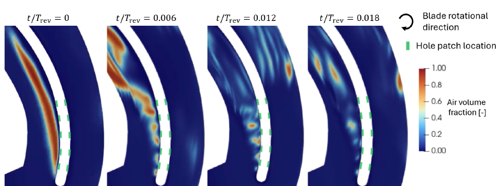
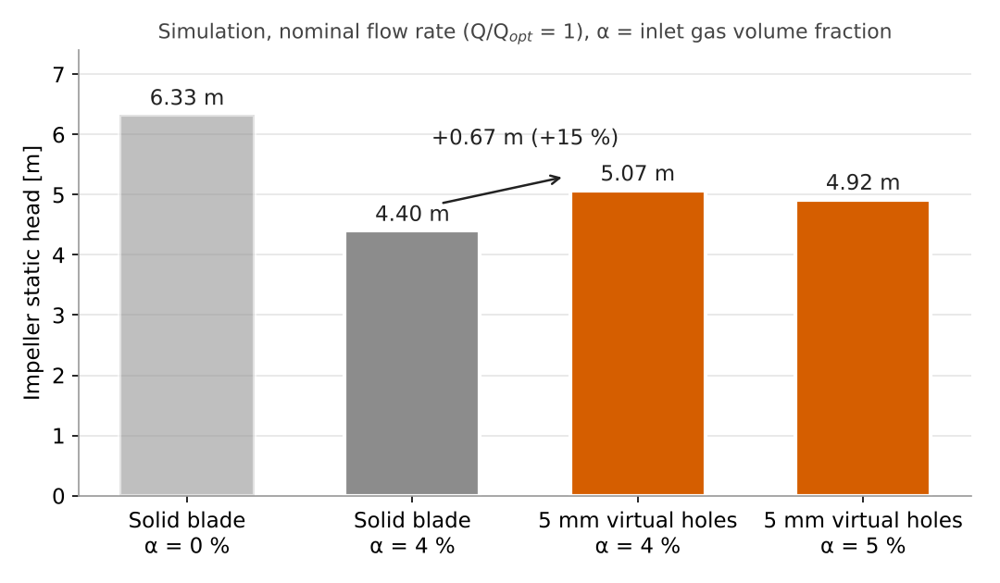

# Virtual Hole Method

**Flushing holes in pump impeller blades, simulated without changing the CAD or the mesh.**
Each hole is a pair of non-conformal `cyclicACMI` patches on the blade surface, linked through the blade, with a handbook-based hydraulic resistance imposed as a pressure jump. A new hole layout is a `topoSet` edit, not a new geometry.

<p align="center">
<br>
<sub>Two-phase simulation at 4 % inlet gas volume fraction, started from an impeller channel with an established air pocket on the suction side. Once the five virtual holes (green) are active, water from the pressure side breaks up the pocket within a few hundredths of a revolution.</sub>
</p>

I developed this method in a publicly funded research project with industrial pump manufacturers (2023–2026) at the Chair of Hydraulic Fluid Machinery, Ruhr University Bochum. It replaced the geometry-and-meshing step for every hole variant, cut design iterations from weeks to minutes, and was adopted by the project's industrial partners.

## The problem

When centrifugal pumps carry gas–liquid mixtures, gas collects in a pocket on the **suction side of the impeller blades**. The pocket blocks the passage and costs head, and above a certain gas content it can stop the pump delivering at all. One practical counter-measure is to drill a few **flushing holes** through the blades at mid-span. The pressure difference across the blade then drives water from the pressure side through the holes, and the jets break up the gas pocket.

For an experiment this is cheap: drill the holes and measure. For simulation it is expensive:

| Step | Geometry-resolved holes |
|---|---|
| CAD | New impeller model for every hole number, diameter and position |
| Meshing | The biggest hurdle. Real drilled holes have rounded edges of non-zero radius; resolving them needs very fine local cells and an unstructured mesh around each bore |
| Cost | Enormous computational effort to resolve the rounded edges, repeated for every variant |

A parameter study over hole number, size and position was therefore not practical with resolved holes.

## The idea

The method combines two OpenFOAM features that, to my knowledge, had not been used together for this purpose:

1. **`cyclicACMI` coupling.** Any set of existing faces on the pressure side can be coupled to a set on the suction side, even though the two sets do not coincide in position or in mesh. This is a step beyond an ordinary non-conformal interface, where the two sides at least occupy the same surface. Faces that lie inside the drawn hole outline let flow through; the rest of the blade stays a wall.
2. **A porous-baffle pressure jump.** OpenFOAM's `porousBafflePressure` imposes a Darcy–Forchheimer pressure drop across a baffle, but only on conformal `cyclic` patches. I rebuilt it on the AMI framework as `porousBafflePressureAMI` (this repository), so it works on `cyclicACMI` pairs.

Without the jump, the hole would be a lossless short-circuit between the two blade sides, and far too much flow would pass through it. The Forchheimer term is simply a general hydraulic resistance, Δp/ρ = k₂U². So instead of tuning it, I took its coefficient from **Idelchik's handbook of hydraulic resistances**: entrance loss + friction loss + Borda–Carnot exit loss of a short bore. The pressure loss therefore follows from the hole geometry and is not a free parameter. See [docs/hydraulic-resistance.md](docs/hydraulic-resistance.md).

| | Geometry-resolved holes | Virtual holes |
|---|---|---|
| Hole representation | Meshed bore through the blade | Pair of `cyclicACMI` patches on the pressure and suction sides, coupled through the blade |
| Hole loss | Resolved | Pressure jump Δp/ρ = k₂U², k₂ from handbook loss coefficients |
| New variant | New CAD + new mesh + new setup | Edit hole centres and diameter in `topoSetDict`, rerun two utilities |
| Mesh | Unstructured, refined around each bore | Unchanged (here ≈ 1 M cells for one blade passage), no local refinement needed |
| Extra cost per run | Large: very fine cells at the rounded hole edges | None |
| Turnaround per variant | Weeks | Minutes |

## Results

The evidence was built up in steps. Details and all figures are in [docs/results.md](docs/results.md).

| Step | Case | Outcome |
|---|---|---|
| 1 | 2D channel with an inclined plate, Re = 20 000, k-ω SST, conformal hole patches | Without the jump, the flow through the "hole" is far too large and keeps increasing. With the jump it settles at less than half, with a clear pressure drop across the hole |
| 2 | Same, 3D, Re = 200 000, **non-conforming** patches (different mesh and geometry on each side) | Mass flow conserved through the coupling; pressure drop across the hole present; same behaviour as in 2D |
| 3 | Pump, single blade passage, one hole, single-phase | Stable and convergent; time-averaged head unchanged within the ±2 % oscillation; suction-side separation reduced |
| 4 | Pump, five holes, k₂ = 0.6 vs 0 vs 30 | Through-flow responds to the resistance as intended |
| 5 | Pump, single-phase head at Q/Q<sub>opt</sub> = 0.4, 1.0, 1.4 | Small head drop with holes, shrinking with flow rate. The project measurements show the same sign and trend; the magnitude is underpredicted |
| 6 | Pump, two-phase, 4 % and 5 % inlet gas, nominal flow | Holes flush the suction-side air pocket. Simulated impeller head at 4 % rises from 4.40 m to 5.07 m (+15 %), recovering about a third of the loss caused by the gas. The measurements also show a head recovery |

A geometry-resolved simulation on an unstructured mesh was also run for comparison. It captured the same trend, with only slightly better accuracy.

<p align="center">
<br>
<sub>Simulated impeller static head, single blade passage, nominal flow rate. The project measurements (pump head, not published) show the same direction of recovery at 4 %.</sub>
</p>

## Quick start

```bash
source /opt/openfoam9/etc/bashrc
./Allwmake                                  # -> $FOAM_USER_LIBBIN/libporousBafflePressureAMI.so
python3 tools/hole_resistance.py --d 0.005 --L 0.005 --zeta-in 0.15 --lam 0.05 --zeta-out 1.0
```

Then follow [docs/workflow.md](docs/workflow.md): select the faces with `topoSet`, create the `cyclicACMI` pairs with `createBaffles`, and set `porousBafflePressureAMI` on the pressure field of each pair:

```c++
// system/controlDict
libs ("libporousBafflePressureAMI.so");

// 0/p  (0/p_rgh for multiphaseEulerFoam), both patches of each hole pair
hole1_ps
{
    type            porousBafflePressureAMI;
    patchType       cyclicACMI;
    jump            uniform 0;
    D               0;          // [1/m^2] Darcy term, negligible for this flow
    I               240;        // [1/m]   = 2 k2 / L,  k2 = 0.6, L = 5 mm
    length          0.005;      // [m]     hole length = blade thickness
    // multiphaseEulerFoam: phi phi.water; rho rho.water; phase water;
    value           uniform 0;
}
```

## Documentation

| Page | Content |
|---|---|
| [docs/method.md](docs/method.md) | How the coupling and the jump work, implementation notes, single-phase and multiphase use, MRF |
| [docs/hydraulic-resistance.md](docs/hydraulic-resistance.md) | From Idelchik loss coefficients to k₂ and `I`, worked example, sensitivity |
| [docs/workflow.md](docs/workflow.md) | Step by step: from a solid-blade case to a virtual-hole case, and how to change a variant |
| [docs/results.md](docs/results.md) | Verification and validation, all figures |
| [docs/limitations.md](docs/limitations.md) | What the method does not capture, and when to use resolved holes instead |
| [tools/hole_resistance.py](tools/hole_resistance.py) | Calculator: hole geometry and loss coefficients → `I` |

## Repository layout

```
src/porousBafflePressureAMI/   boundary condition (OpenFOAM Foundation v9)
tools/hole_resistance.py       loss coefficients -> BC coefficients
docs/                          method, workflow, resistance model, results, limitations
examples/                      generic demonstration case (planned)
Allwmake                       builds the library
```

## Licence

GPL-3.0 (derived from OpenFOAM), see `LICENSE`. This offering is not approved or endorsed by the OpenFOAM Foundation or OpenCFD Ltd., producer and distributor of the OpenFOAM software and owner of the OpenFOAM® trademark.

Reference: Idelchik, I. E. (1954) *Fluid Resistances (Physical and Mechanical Fundamentals).* Gosenergoizdat, Moscow.
