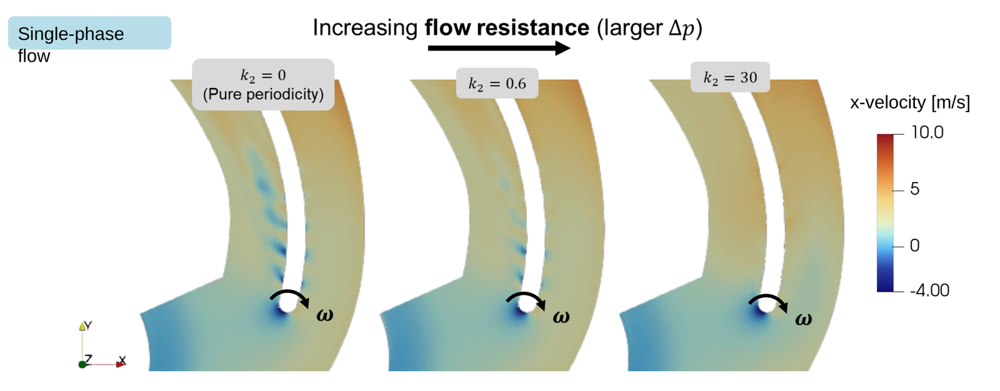

# Hydraulic resistance of a hole

[← Overview](../README.md) · [Method](method.md) · [Workflow](workflow.md) · [Results](results.md) · [Limitations](limitations.md)

The Forchheimer term in a porous baffle, Δp/ρ = ½ I L U², is nothing more than a quadratic hydraulic resistance. A drilled hole is a classic hydraulic resistance, so its coefficient does not need to be tuned. It can be **assembled from handbook loss coefficients** for the geometry of the hole. I used Idelchik's *Fluid Resistances* [Ide54], which compiles experimental loss data for entrances, pipe sections, orifices and expansions.

## 1. Loss coefficients of a short bore

A hole through a blade is a short pipe: flow enters from a large space (the pressure-side passage), runs through a bore of length L and diameter d, and discharges into another large space (the suction-side passage). Its total loss coefficient, referred to the mean velocity U in the bore, is the sum of three parts:

```
Δp = ζ · ρ U² / 2,        ζ = ζ_entrance + ζ_friction + ζ_exit
```

| Part | Physics | Value used | Source |
|---|---|---:|---|
| ζ<sub>entrance</sub> | Contraction at the bore inlet. 0.5 for a sharp edge; lower when the edge is rounded | **0.15** | Idelchik, entrance with rounded edge |
| ζ<sub>friction</sub> | Wall friction along the bore, λ L/d | **0.05** (λ = 0.05, L/d = 1) | Darcy friction factor |
| ζ<sub>exit</sub> | Sudden expansion of the jet into the passage; the jet's kinetic energy is lost | **1.0** | Borda–Carnot |
| **ζ** | | **1.20** | |

For drilled holes the edges are rounded, not sharp, which is why the rounded-entrance value is used. The same rounding is what makes a geometry-resolved mesh so expensive.

## 2. From ζ to the boundary-condition coefficients

Written in the form used in the project,

```
−Δp / ρ = k₂ U²      →      k₂ = ζ / 2 = 0.60
```

The boundary condition imposes Δp/ρ = (D ν U + ½ I U²)·L. With D = 0:

```
½ I L = k₂      →      I = 2 k₂ / L = ζ / L
```

### Worked example (project values)

| Input | Value |
|---|---|
| Hole diameter d | 5 mm |
| Hole length L = blade thickness | 5 mm |
| ζ = 0.15 + 0.05 + 1.0 | 1.20 |
| k₂ = ζ/2 | 0.60 |
| **I = 2 k₂ / L** | **240 m⁻¹** |
| D | 0 |

```bash
$ python3 tools/hole_resistance.py --d 0.005 --L 0.005 --zeta-in 0.15 --lam 0.05 --zeta-out 1.0 --U 1 2 4
zeta (sum)               = 1.200
k2 = zeta/2              = 0.600
I  = 2 k2 / L            = 240.0 1/m   (with D = 0, length = 0.005 m)

  U [m/s]   dp/rho [m2/s2]   dp [kPa] (water, 998 kg/m3)
     1.00            0.600        0.599
     2.00            2.400        2.395
     4.00            9.600        9.581
```

Note that `I` depends on the `length` you enter: only the product I·L is physical. If the blade thickness changes, recompute `I`.

## 3. How sensitive is the result to k₂?

The resistance only matters if the hole flow responds to it. The single-phase blade-passage simulation was repeated with three values:

<p align="center"></p>

| k₂ | Meaning | Through-flow |
|---|---|---|
| 0 | Pure periodicity: a lossless short-circuit | Strongest jets on the suction side |
| 0.6 | Handbook value for this hole | Weaker jets |
| 30 | Practically closed | Jets nearly gone; the flow approaches the solid blade |

The flow field changes in the intended direction with k₂. For a fixed pressure difference across the blade, the hole velocity scales roughly as U ∝ (Δp/ρk₂)<sup>1/2</sup>. An error of ±20 % in ζ therefore changes the hole flow by only about ∓10 %. The exit loss (ζ = 1.0) is the dominant and best-established part. The entrance value is the most uncertain, and ranges from 0.5 for a sharp edge down to about 0.03–0.1 for a well-rounded inlet.

## 4. Things to watch

- **Reference velocity.** Handbook ζ values are referred to the mean velocity *in the bore*. The boundary condition uses the face-normal velocity on the selected faces. These agree only if the selected face area matches the hole area πd²/4. Faces are selected by their centre lying inside the hole circle, so the area is a staircase approximation; on a coarse blade mesh, check it (see [workflow](workflow.md#check-the-hole-area)).
- **Cross-flow.** The handbook values are for flow from and into a quiescent space. In an impeller, both openings sit in a fast tangential flow, which changes the entrance and exit losses. This is not included.
- **Two-phase flow.** The same single-phase ζ is applied to the shared pressure, with the water-phase velocity. Gas passing through the hole is not given a separate resistance.

## Reference

[Ide54] Idelchik, I. E. (1954) *Fluid Resistances (Physical and Mechanical Fundamentals).* Gosenergoizdat, Moscow, 316 p. Later editions in English: *Handbook of Hydraulic Resistance.*
