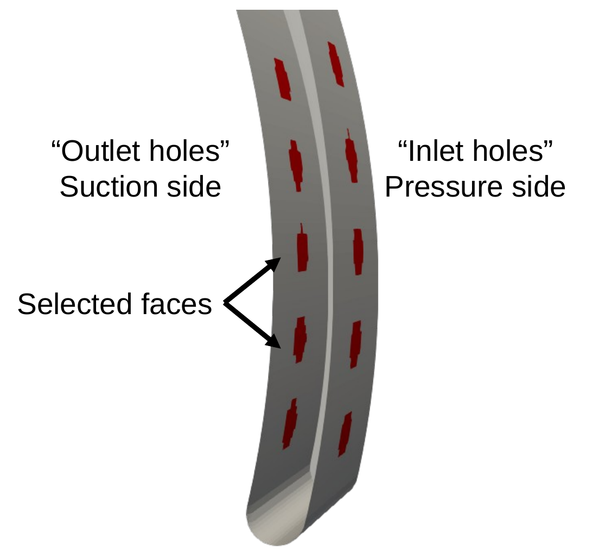

# Method

[← Overview](../README.md) · [Hydraulic resistance](hydraulic-resistance.md) · [Workflow](workflow.md) · [Results](results.md) · [Limitations](limitations.md)

## 1. A hole as a coupled pair of face sets

A drilled hole connects a small area on the pressure side of the blade with a small area on the suction side. The method reproduces exactly that connection on the *existing* blade mesh:

<p align="center"></p>

1. On each side of the blade, select the wall faces whose **face centres lie inside the hole circle** (true hole position and diameter). The outline is therefore the staircase approximation of the circle on the blade surface mesh.
2. Turn the two face sets into a **`cyclicACMI` pair**. Flow leaving the domain through the pressure-side set re-enters through the suction-side set, and vice versa.
3. Put the **pressure jump** of `porousBafflePressureAMI` on the pair. The pressure on the outlet side is lowered by the hole's hydraulic loss.

### Why `cyclicACMI` and not plain `cyclic` or `cyclicAMI`

| Coupling | Requirement on the two sides | Usable here? |
|---|---|---|
| `cyclic` | Identical faces, one-to-one, related by a fixed transform | No: the two blade sides have different meshes |
| `cyclicAMI` | Different meshes allowed, but the two surfaces must cover each other | Only if the selected face sets matched in shape; the staircase outlines on the two sides do not |
| `cyclicACMI` | Different meshes *and* partial coverage. Where a face is not covered by the other side, the flow sees the associated non-overlap patch | **Yes** |

`cyclicACMI` (arbitrarily *coupled* mesh interface) weights each face by how much of it is covered by the opposite side. The uncovered fraction is assigned to a companion **non-overlap patch**, a required part of every `cyclicACMI` patch in OpenFOAM. Here the non-overlap patch is a wall, so any part of the hole outline without a counterpart on the other side behaves as blade wall. The coupling is therefore robust to the two staircase outlines not matching. Mass is conserved through the coupling; this was checked explicitly in the 3D test case ([results, step 2](results.md#step-2-3d-non-conforming-patches)).

### Why a pressure jump is needed

A bare `cyclicACMI` pair is a lossless short-circuit between the high-pressure and low-pressure sides of the blade. The flow through it is then set only by the pressure difference and wall friction, and is far too large. In the 2D test it did not even settle. A real bore has an entrance loss, friction and an exit loss. The jump adds exactly that.

## 2. The pressure jump

`porousBafflePressureAMI` imposes, face by face, the Darcy–Forchheimer form used by OpenFOAM's `porousBafflePressure`:

```
Δp = −sign(φ) · ( D μ |Uₙ|  +  ½ I ρ |Uₙ|² ) · L
```

| Symbol | Meaning | Here |
|---|---|---|
| φ | face flux; its sign makes the jump always oppose the flow | – |
| Uₙ | face-normal velocity, \|φ\| / \|S<sub>f</sub>\| | velocity through the hole |
| D | Darcy (viscous) coefficient [1/m²] | 0 (high-Reynolds-number bore flow, inertial losses dominate) |
| I | inertial (Forchheimer) coefficient [1/m] | from handbook loss coefficients, see [hydraulic-resistance.md](hydraulic-resistance.md) |
| L | `length` of the porous layer [m] | hole length = blade thickness (5 mm) |
| μ, ρ | viscosity and density | from the (phase) transport model; incompressible solvers work in kinematic pressure, ρ = 1 |

With D = 0 this is the handbook form of a local loss, Δp/ρ = k₂ U², with k₂ = ½ I L.

### Implementation

The boundary condition is OpenFOAM-9's `porousBafflePressure` rebuilt on `fixedJumpAMIFvPatchField<scalar>` instead of `fixedJumpFvPatchField<scalar>`. This is what makes it valid on `cyclicAMI` and `cyclicACMI` patches.

- The jump is computed on the **owner** patch only. The neighbour patch receives the negated value, interpolated through the AMI weights, from the base class. Both sides are therefore consistent by construction.
- Uₙ is taken from the face flux, not from the cell velocity. On the hole faces this is the through-blade velocity.
- **Single-phase** (`pimpleFoam`, `simpleFoam`): uses `phi` and the kinematic viscosity of `momentumTransport`; the jump is in m²/s².
- **Multiphase** (`multiphaseEulerFoam` and derived solvers): set `phi phi.water; rho rho.water; phase water;`. The jump is then computed from the water-phase flux, density and viscosity (`momentumTransport.water`) and applied to the shared pressure. With φ<sub>water</sub> = α<sub>water</sub> U·S<sub>f</sub>, Uₙ is the water superficial velocity through the hole. When the hole carries mostly water, which is its purpose, this is close to the true water velocity.
- Rotating frame: works with **MRF** impeller simulations, which is how it was used in the project.

### Optional safeguards

Two optional keywords were added while developing the method on rotating blade passages:

| Keyword | Effect | When it may help |
|---|---|---|
| `positive true \| false` | Forces the jump sign (`false`: jump ≤ 0). Wrong-sign faces are flipped, keeping the magnitude | If the face flux on a converted wall face has a persistently wrong sign, e.g. a tiny normal residual of a large tangential velocity |
| `jumpMax` | Bounds \|jump\| on every face (default 1e3) | If the MRF correction of the flux on ACMI faces inflates Uₙ and hence the jump |

They are off by default, and **were not needed in the final project simulations**. They are kept as diagnostics. If you need them, first check the face selection and the initial field.

The full option table is in the header of [`porousBafflePressureAMIFvPatchField.H`](../src/porousBafflePressureAMI/porousBafflePressureAMIFvPatchField.H).
