# Results: verification and validation

[← Overview](../README.md) · [Method](method.md) · [Hydraulic resistance](hydraulic-resistance.md) · [Workflow](workflow.md) · [Limitations](limitations.md)

The method was built up in six steps. Each step answered one question before the next added complexity: does the coupling work, does it work on non-matching patches, does the pump case run stably, does the resistance behave as intended, and does the method predict the effect of the holes?

| Step | Question | Case | Flow |
|---|---|---|---|
| [1](#step-1-2d-test-coupling-with-and-without-the-jump) | Does a coupled patch pair act as a hole, and does the jump limit its flow? | 2D channel with inclined plate | single-phase |
| [2](#step-2-3d-non-conforming-patches) | Does it still work when the two sides do not match? | 3D channel with inclined plate | single-phase |
| [3](#step-3-pump-one-hole-in-a-single-blade-passage) | Is it stable in a rotating pump passage? | Impeller, one hole | single-phase |
| [4](#step-4-pump-five-holes-and-resistance-sensitivity) | Does the resistance control the through-flow? | Impeller, five holes | single-phase |
| [5](#step-5-single-phase-head-over-the-operating-range) | Is the head penalty of the holes predicted? | Impeller, three flow rates | single-phase |
| [6](#step-6-two-phase-flushing-and-head-recovery) | Do the holes flush the gas, and is the head recovery predicted? | Impeller, 4 % and 5 % gas | two-phase |

All cases used k-ω SST. Pump simulations were made on a single blade passage of the impeller in an MRF frame (about 1 M cells), with `pimpleFoam` for single-phase and a `multiphaseEulerFoam`-based solver for two-phase flow. The full pump was too expensive for a parametric study. The simulated head is therefore the **impeller static head**, while the project's measurements are the **pump head** (impeller and casing). The two are compared by trend, not by absolute value. The measured data belong to a project partner and are not published here.

---

## Step 1: 2D test, coupling with and without the jump

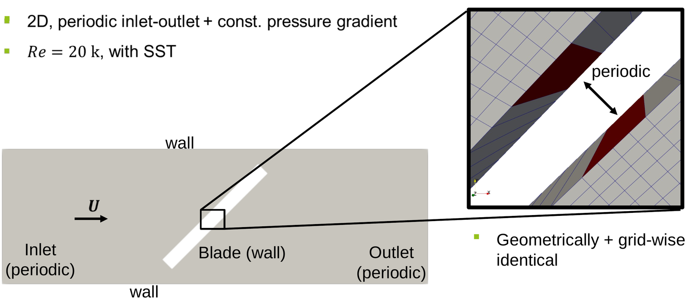

A periodic channel driven by a constant pressure gradient (Re = 20 000) contains an inclined plate ("blade"). A small patch on each side of the plate forms the "hole". In this first test the two patches are geometrically and mesh-wise identical.

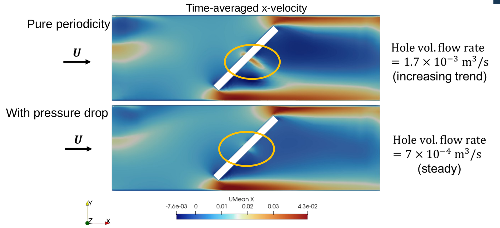

| | Pure periodicity (no jump) | With pressure jump |
|---|---|---|
| Flow through the hole | 1.7 × 10⁻³ m³/s and still increasing | 7 × 10⁻⁴ m³/s, steady |

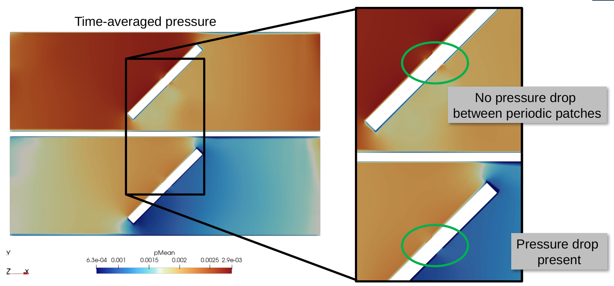

Without the jump, the pressure is continuous across the hole, so nothing limits the through-flow. With the jump, there is a clear pressure drop across the hole and the flow settles at less than half.

## Step 2: 3D, non-conforming patches

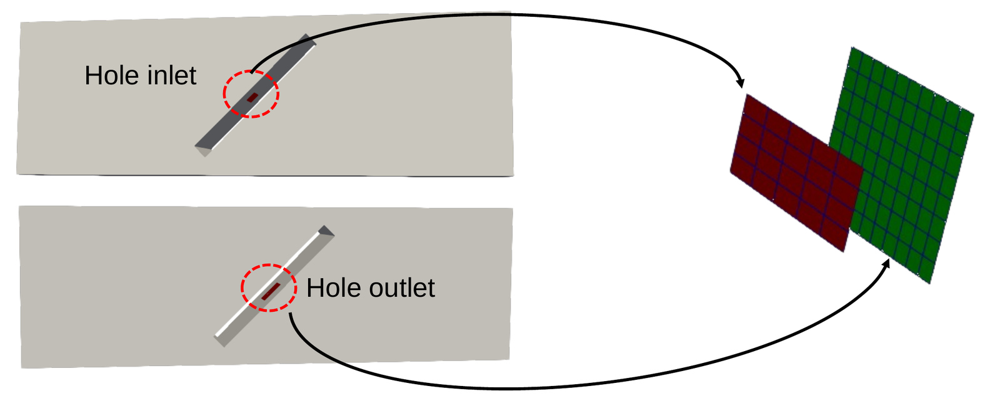

The same set-up in 3D at Re = 200 000, now with patches that **do not match**, neither in mesh nor in geometry: the situation on a real blade.

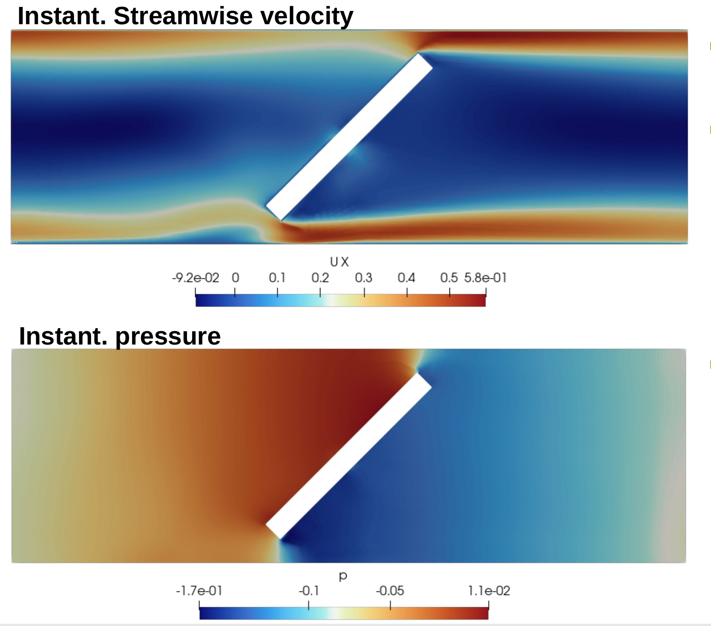

After three flow-through times:
- mass flow is conserved through the coupling;
- the pressure drop from hole inlet to hole outlet is present;
- the flow through the hole is not accelerated, which is the same behaviour as in 2D.

## Step 3: pump, one hole in a single blade passage

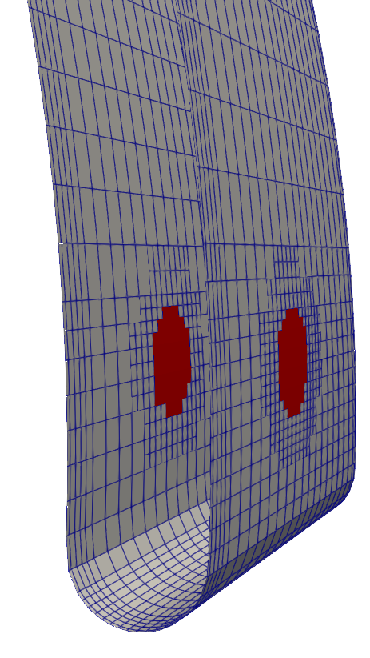

The hole nearest the leading edge (of five) was introduced first. The cell faces were selected from the actual hole diameter; the two patches are non-conforming. The single-phase run was initialised from the solid-blade solution.

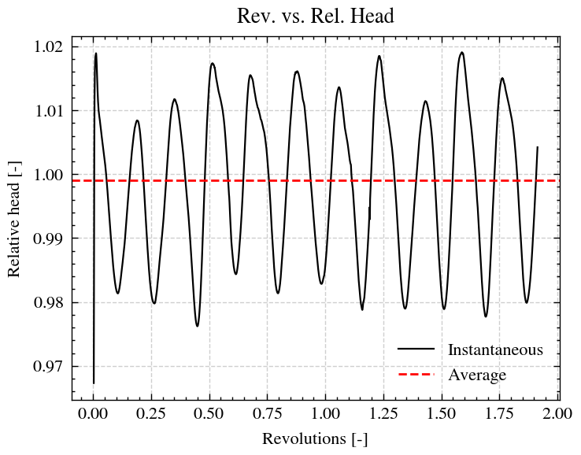

- The simulation is stable and converges.
- The head, relative to the solid blade, oscillates by up to about ±2 %; its time average is essentially unchanged (≈ 1.00).

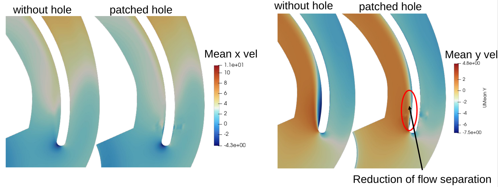

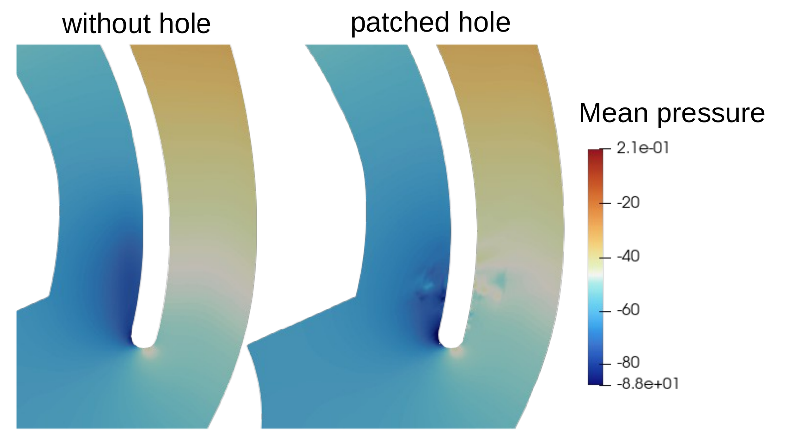

The mean velocity shows a smaller flow separation on the suction side downstream of the hole. The mean pressure field is not significantly different. In this early test the blade-surface mesh around the hole was locally refined first. This turned out to be unnecessary and was dropped in the final workflow.

## Step 4: pump, five holes and resistance sensitivity

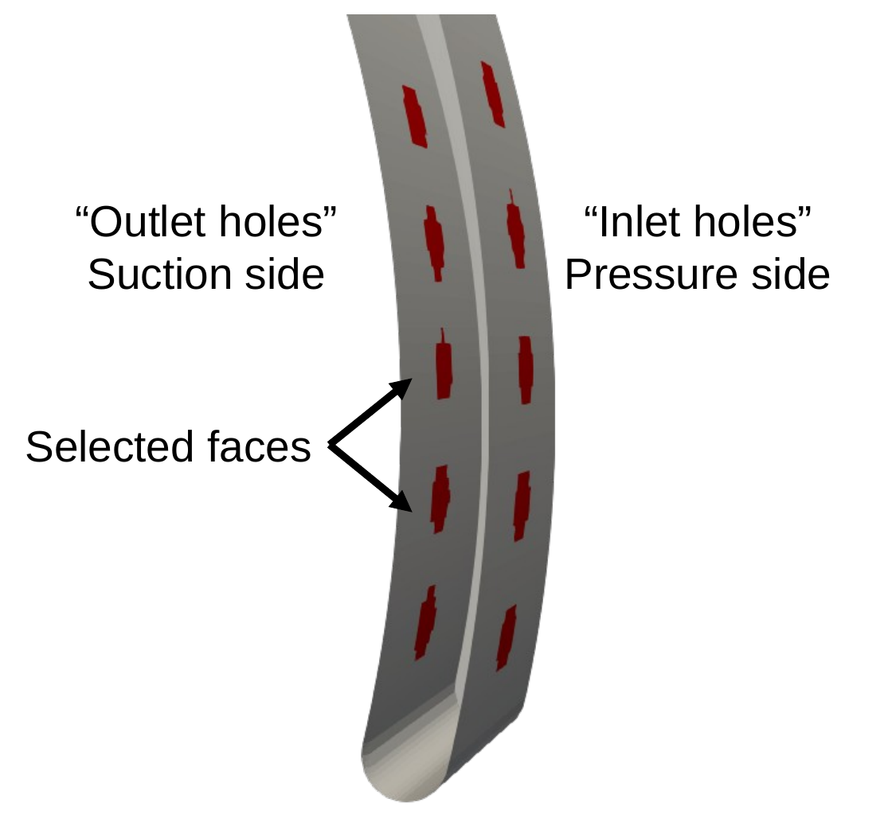

Five hole pairs at mid-span, faces selected from the true hole positions and diameter, with k₂ = 0.6 from [the handbook loss coefficients](hydraulic-resistance.md).

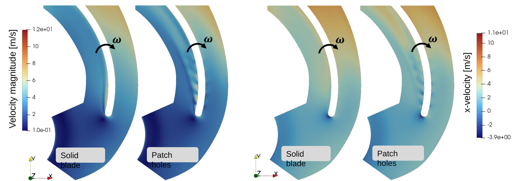

The jets through the holes are clearly visible on the suction side and change the passage flow.

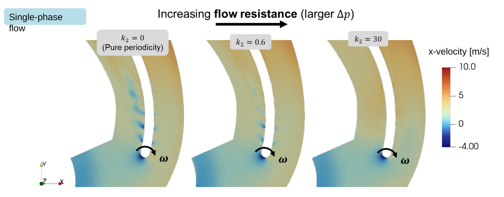

Raising the resistance from k₂ = 0 (pure periodicity) to 0.6 and 30 weakens the jets step by step, as intended.

## Step 5: single-phase head over the operating range

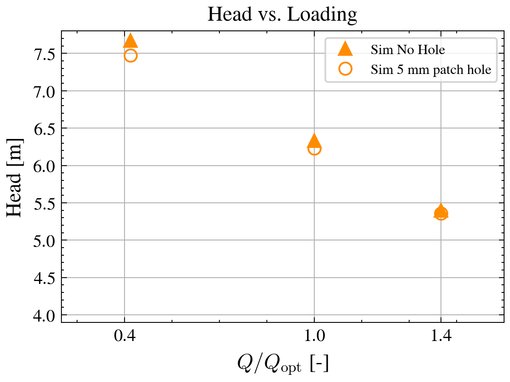

| Q/Qopt | Simulation: effect of five 5 mm holes on impeller static head |
|---|---|
| 0.4 | small drop |
| 1.0 | smaller drop |
| 1.4 | practically none |

- **Trend.** The measurements show a consistent, marginal head drop with holes at all three flow rates, shrinking as the flow rate rises. The simulation reproduces this sign and this trend.
- **Magnitude.** The simulated head drop is smaller than the measured one.
- **Absolute level.** Simulated impeller head and measured pump head differ by definition, most visibly at 1.4 Qopt, so absolute values are not compared.

## Step 6: two-phase flushing and head recovery

Nominal flow rate (Q/Qopt = 1), inlet gas volume fraction αa,inlet = 4 % and 5 %, transient. The run starts from the solid-blade solution, where an air pocket has formed on the suction side.

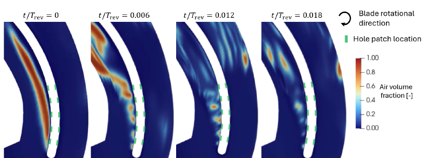

Within about 2 % of a revolution (t/Trev = 0.018), the jets break the continuous pocket into small fragments, which are carried away.

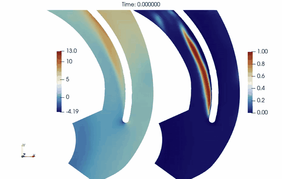 
Left: water x-velocity [m/s]. Right: air volume fraction [–]. Time in seconds from switching on the holes.

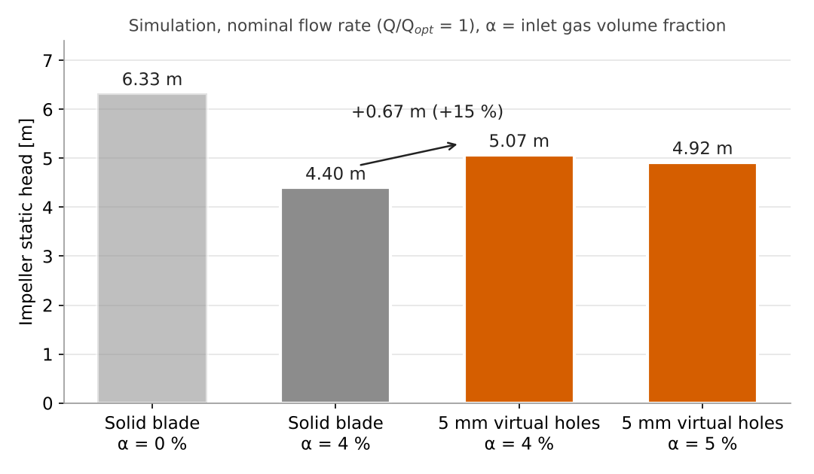

| Simulation, impeller static head | Head [m] |
|---|---:|
| Solid blade, single-phase | 6.33 |
| Solid blade, α = 4 % | 4.40 |
| 5 mm holes, α = 4 % | 5.07 |
| 5 mm holes, α = 5 % | 4.92 |

- **Simulated recovery.** At 4 % gas, the holes recover 0.67 m (+15 %), about a third of the 1.93 m lost to the gas. With holes at 5 % gas, the head is still above that of the solid blade at 4 %.
- **Comparison with the measurement.** The measured pump head also rises with holes at 4 %, so the direction of the effect is captured. The simulated recovery is larger than the measured one. Because the head definitions differ (impeller static head vs pump head), the comparison is by trend only.

## Summary of the evidence

| Claim | Evidence |
|---|---|
| A coupled patch pair acts as a hole | Steps 1–2: through-flow and jets |
| It works on arbitrary, non-matching face sets | Step 2: mass conserved; step 3: stable on a real blade |
| The resistance controls the through-flow | Steps 1 and 4 |
| The head penalty of holes in single-phase flow is captured in sign and trend | Step 5 |
| The flushing of a gas pocket and the resulting head recovery are captured in direction | Step 6 |
| A geometry-resolved simulation (unstructured mesh) gives the same trend, only slightly more accurate | Run in the project for comparison |
